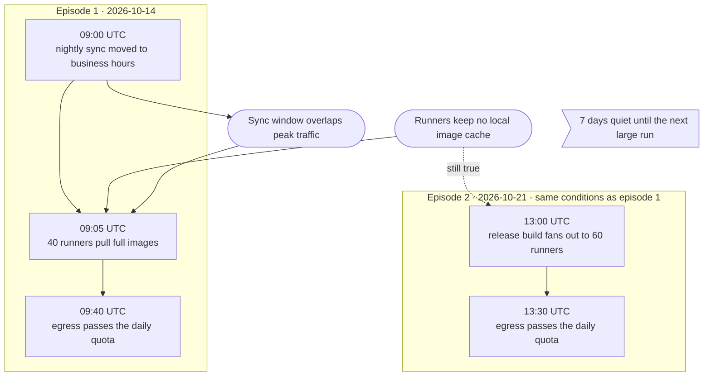

# Diagram Practices

These rules cover diagrams that plot no data: data flows, sequences, state machines, causal charts, and boundaries.
Charts of data follow the `data-visualization` skill instead. The skills that draw diagrams point here: `walkthrough`,
`presentation`, `rca`, and `session-report`.

## When a Diagram Earns Its Place

Most explanations need no diagram. A diagram earns its place only when its shape is the claim, and a sentence cannot
carry that shape. These shapes earn one:

- Paths that branch or merge
- A cycle or feedback loop
- Nested boundaries, such as which services run inside which account
- Fan-in or fan-out past three
- Several actors exchanging messages in order
- Events and the conditions that let them happen, in time order

These shapes do not:

- A straight chain. `A -> B -> C` is a sentence with arrows. Write the sentence
- A hub with a few spokes. That is a bullet list
- Three or four boxes with a line or two between them
- A file tree. It reads as a list, so make it a list
- A diagram whose labels repeat the prose beside it

Before drawing one, write the sentence that says what the reader should notice. When that sentence, or up to three
bullets, carries everything the picture shows, use the text. Prefer a table when the claim is a comparison of values.

## Choosing the Diagram

| The information | The diagram |
|-----------------|-------------|
| Components and what flows between them | Data flow: boxes, with edges labeled by what flows |
| Messages between actors, in order | Sequence diagram |
| One system's states and the transitions between them | State machine |
| How an incident unfolded, and what let each step happen | Events and causal factors chart |
| Which causes must co-occur, and where one fix cuts the outcome | Fault tree |
| What runs inside which boundary | Data flow with nested containers |
| Before and after a change | Two diagrams of the same family, side by side |
| A schedule or a timeline of work | Gantt or timeline chart |

- Put sample data on data-flow edges. `{id: 42, amount: 1999}` beats a bare arrow
- Use a state machine only for one system's states. Causality that runs one way across several systems is an events
  and causal factors chart
- Never draw a flowchart whose rows mix states and actions. Readers cannot tell what is a thing and what happened
- Never draw ASCII diagrams
- Pick two or three diagram families for a page or a deck, and reuse them. Six styles read as six documents

## Events and Causal Factors Charts

An events and causal factors chart, or ECF chart, is the default causal diagram whenever time order matters.

- Events are rectangles on one spine, in time order. Each event's label starts with its absolute timestamp on its own
  line, then a short description
- Conditions are ovals. A condition attaches to the event that created it, as event to condition, or to the event it
  enabled, as condition to event
- Mark a standing condition, one that was true before the incident began, with a dashed outline. A condition an event
  created keeps a solid outline
- A causal factor is a condition whose removal would have prevented the outcome. Give it the `causal` style: a heavy
  outline in the focus tint
- Give the bad outcome the `danger` tint

Recurring incidents split into episodes:

- Draw each episode as its own container, titled with its date. Never draw an arrow from one episode's outcome to the
  next episode's first event
- Put an elapsed-time marker between episodes, such as "7 days quiet until the next large run"
- A condition that persists across episodes gets one connector, labeled "still true", to where it bites again. Title
  the repeat "same conditions as episode 1" instead of redrawing the conditions
- A burst on the same day with a different cause is its own episode. Do not merge it into its neighbor

A fault tree answers a different question. Use one only to show which causes must co-occur, and where a fix cuts the
outcome. Use AND and OR gates, and put each fix's identifier on the basic event it removes. A fault tree drops time
order, so it never replaces the ECF chart. It can sit beside it.

In Mermaid, an ECF chart is a top-to-bottom flowchart:



## Renderers

| Medium | Renderer |
|--------|----------|
| HTML pages, HTML reports, and walkthroughs | Mermaid, rendered in the browser |
| Markdown, such as an rca answer or a wiki entry | Mermaid source in a `mermaid` fence |
| presenterm decks | D2, with the ELK layout engine |

- Pin Mermaid to an exact version, 12.2.0 or later. Mermaid 12 bundles the ELK layout
- Configure Mermaid with `theme: 'base'`, `look: 'neo'`, and `layout: 'elk'`. `base` is the only theme whose colors can
  be replaced
- Set D2's `layout-engine: elk` in each diagram's `vars.d2-config`
- In a deck, use Mermaid only for what D2 does not draw: `gantt`, `timeline`, `sankey`, `pie`, `xychart`,
  `quadrantChart`, and `gitGraph`

Never use these:

- Mermaid's built-in themes: `default`, `dark`, `neutral`, `forest`, `neo`, `neo-dark`, and the `redux` family. Their
  edge labels sit on fixed greys that the page cannot fix, and some fail contrast
- Mermaid's `handDrawn` look, or D2's sketch mode
- D2's built-in palettes, or presenterm's d2 theme, showing through. Override every slot
- Graphviz. It reads poorly even with every attribute set from the page tokens. Leave a project's existing Graphviz
  diagrams alone unless asked to redraw them

## Styling

Every color in a diagram comes from the page's color tokens, in both light and dark. No diagram source carries a hex
color. The page maps its tokens into the renderer when it renders.

Mermaid takes them as `themeVariables` on the `base` theme. The walkthrough template's `mermaidConfig()` holds the full
mapping. Its core:

| Mermaid variable | Token role |
|------------------|------------|
| `primaryColor`, `mainBkg`, `actorBkg` | Node fill, a grey a step off the surface |
| `primaryBorderColor`, `nodeBorder`, `actorBorder` | A strong grey border |
| `primaryTextColor`, `textColor` | Body text |
| `lineColor`, `signalColor` | Dim text color |
| `edgeLabelBackground`, `background` | The figure's surface |
| `clusterBkg`, `clusterBorder` | The page background, and the hairline border |
| `noteBkgColor`, `noteBorderColor` | The focus tint |

Set `nodeBorder` explicitly. Without it, the neo look draws a gradient border on `base`.

### Semantic Tints

Nodes are grey. A tint marks the few nodes the reader should notice, and nothing else.

| Class | Tint | Means |
|-------|------|-------|
| none | grey | An ordinary node. Most nodes |
| `focus` | blue | Look here: the subject of the diagram |
| `danger` | red | A failure or a bad outcome |
| `warn` | amber | A warning, or a gate at risk |
| `ok` | green | Healthy, or success |
| `causal` | blue, heavy outline | An ECF causal factor |
| `standing` | dashed outline | An ECF standing condition |
| `marker` | dotted outline | An elapsed-time marker between episodes |

- Tint a few nodes. When most of a diagram is tinted, nothing stands out
- Text keeps the body color on every tint. Only the fill and the border change
- Never let color carry a meaning alone. `danger` also gets a heavier border, and labels name the state. Red and green
  are never the only difference between two nodes
- In a sequence diagram, a note carries the focus tint. Participants stay grey

The walkthrough template defines these classes from the page tokens and adds them to every flowchart and state
diagram. A diagram only names them: `class Failed danger`.

### Labels

- Keep node labels to a few words. Detail goes in the prose
- Wrap labels at about 260px. Set Mermaid's `flowchart.wrappingWidth`
- Break after an ECF event's timestamp with `<br>`, so the time reads on its own line
- Label edges with what flows, such as `-> : invoices`, not a bare arrow

### D2

D2 colors shapes from slot codes. Override every slot with the page tokens in `vars.d2-config.theme-overrides`:

| Slots | Token role |
|-------|------------|
| `N1`, `N2` | Body text |
| `N3` | Dim text |
| `N4`, `B1`, `B2` | Node border |
| `N5`, `B3` | Hairline border |
| `N6`, `B6` | Node fill |
| `N7` | Surface |
| `B4`, `B5`, `AA5`, `AB5` | Page background, for containers |
| `AA2` | Accent |
| `AA4`, `AB4` | Accent tint |

- Turn off D2's bold node labels and italic edge labels: `**.style.bold: false` and
  `(** -> **)[*].style.italic: false`
- Set a tint on each shape: `failed.style: { fill: "..."; stroke: "..."; stroke-width: 3 }`. A second `classes` map
  does not merge into the first, and D2 drops it without an error
- Stroke widths are whole numbers
- A deck renders D2 to an image with fixed colors. Use the palette that matches the deck's theme

### Reference Palette

Use these when a page has no tokens of its own, and for D2 in decks. A page that has tokens uses its own.

| Role | Light | Dark |
|------|-------|------|
| Page background | `#f6f7f9` | `#12161d` |
| Surface | `#ffffff` | `#1a2029` |
| Body text | `#1b2230` | `#e3e8f0` |
| Dim text | `#4a5466` | `#a9b3c3` |
| Hairline border | `#d5dae3` | `#2c3442` |
| Node fill | `#eef1f6` | `#232b38` |
| Node border | `#7d889c` | `#7a869a` |
| Focus | `#2f5fd0` on `#e4ebfb` | `#8aabf7` on `#243152` |
| Danger | `#c4322b` on `#fbe6e4` | `#f2877d` on `#3f2323` |
| Warn | `#a15c00` on `#fcefd6` | `#e2a64a` on `#3b2f18` |
| Ok | `#2c7a41` on `#e1f2e5` | `#7ccf91` on `#1e3427` |

## Readability

- Render every diagram at its natural size. Never scale it down to fit. A diagram wider than its container scrolls
  sideways inside its own `overflow-x: auto` box
- Give a wide diagram a full-width row. A left-to-right flow in a half-width card shrinks to unreadable
- Every label meets 4.5:1 contrast against what sits directly behind it, in both themes. Measure it. See "Checking a
  Rendered Page"
- Use the page's font in the diagram

## Checking a Rendered Page

Check an HTML page in a browser before reporting it done. A static check cannot see layout, contrast, or a diagram that
failed to render.

- Screenshot with headless Chrome: `--headless=new --screenshot=<file> --window-size=<W>,<H>`. Add
  `--virtual-time-budget=10000` so async rendering such as Mermaid finishes first
- Headless Chrome lays out no narrower than about 500px. At `--window-size=390,<H>` the page lays out at 500px and the
  capture clips to 390px, so it is not a phone check. Use device emulation instead, such as the chrome-devtools
  `emulate` tool
- To capture part of a page, use a shorter window height. Cropping afterwards with `sips --cropOffset` does not land
  where expected
- Make each tab selectable by a `#hash`, so each one can be captured
- Check light and dark. Look at each screenshot. A clipped label or an unreadable edge is a defect

The walkthrough template measures contrast for you. Open the page with `?audit`, and `&theme=dark` for the dark theme.
Each Mermaid diagram then reports its lowest label contrast in a `data-contrast-min` attribute, and the labels below
4.5:1 in `data-contrast-fails`. Read them headless:

```sh
chrome --headless=new --virtual-time-budget=10000 --window-size=1400,9000 \
  --dump-dom "file:///abs/path/page.html?audit&theme=dark"
```

The audit measures only labels inside the window, so use a tall one. A page built without the template copies its
`auditContrast` function.
